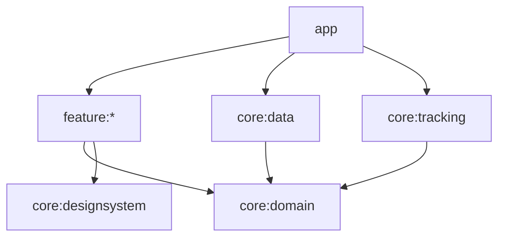

# Arquitetura

O projeto mantém MVVM e aplica fluxo unidirecional na Atividade. Os limites de Clean Architecture são expressos pelas dependências Gradle e pelos contratos Kotlin do domínio.

## Dependências

As setas representam dependências de compilação. O Hilt fornece implementações para os contratos recebidos pelos ViewModels e pelo serviço. Jornada, Atividade e Mochila também reutilizam a apresentação de Missões.

## Domínio

`core:domain` usa Kotlin e coroutines, sem Android, Room, Hilt ou tipos de localização da plataforma. Reúne os modelos e contratos de progresso, perfil, missões, CEP, localização e exercícios.

`WorkoutSessionManager` coordena iniciar, pausar, retomar, finalizar e cancelar. Usa tempo monotônico para duração e tempo civil para a data de início. Retomar reinicia a referência de passos e cria um segmento. Deslocamentos entre segmentos não entram na distância. Finalizar produz um rascunho; salvar o resultado é uma operação persistente separada.

O gerenciador recebe relógio e gerador de ID. Seus métodos são chamados serialmente pelo serviço. A persistência conclui antes da publicação da transição. Falhas preservam o último checkpoint confirmado; sessões interrompidas são recuperadas como pausadas.

As operações complexas de atividade estão nesse coordenador. Consultas simples usam os contratos diretamente, sem casos de uso que apenas repassem chamadas.

## Dados

`RoomAdventureRepository` e `RoomMissionRepository` mantêm progresso e recompensas em transações. `DataStorePlayerRepository` guarda perfil e locais salvos. `HttpCepRepository` consulta a BrasilAPI. `AndroidLocationRepository` adapta a localização de visualização para `GeoLocation`.

`RoomWorkoutRepository` mantém resumos em `workouts` e pontos em `workout_points`. Cada ponto possui posição e segmento; a chave estrangeira remove os pontos junto da atividade. Checkpoints inserem apenas pontos novos e atualizam o resumo na mesma transação. Erros no lote revertem a operação inteira.

A lista de exercícios contém metadados com `route` vazio. `observeRoute(id)` carrega o percurso selecionado; `current()` recupera pontos para retomar uma sessão. Isso evita carregar todos os percursos a cada atualização do cronômetro.

Salvar e descartar retornam `APPLIED`, `NOT_FOUND` ou `INVALID_STATE`. Checkpoints tardios não sobrescrevem resultados finalizados. A migração 4→5 converte o JSON antigo e mantém os demais dados. Dispatchers de rede e transformação de pontos são injetados.

## Integração Android

`StepTrackingService` mantém notificação e listeners. Converte eventos Android em comandos tipados, processados em sequência. O gerenciador decide sobre tempo, distância e progresso. O serviço não conhece Room.

`TrackingController` implementa `WorkoutTracker` e envia comandos ao serviço. A recuperação inicial conclui antes dos comandos. `TrackingRuntime` é compartilhado pelo Hilt durante a vida do processo, sem objeto global estático. O banco permite recuperação após morte do processo; o serviço usa `START_NOT_STICKY`.

## Apresentação

`WorkoutViewModel` recebe `WorkoutAction` e expõe um único `StateFlow<WorkoutUiState>`. Combina resumos, percurso selecionado, tracking e escolhas da interface. O percurso é identificado pelo ID para impedir que uma consulta anterior apareça em outra atividade.

O ViewModel impede operações incompatíveis e salvamentos simultâneos. Comandos são validados novamente pelo gerenciador. Compose apresenta estado e envia ações; o adaptador `WorkoutControls` solicita permissões. A tela não controla uma segunda sessão.

`ProfileForm` representa os textos em edição. `PlayerProfile` usa medidas numéricas e valida seus limites. A conversão aceita vírgula decimal. As demais telas continuam com MVVM e métodos diretos.

## Testes

- Domínio: regras, relógio, GPS, retomada, interrupções e falhas de gravação.
- ViewModel: ações, histórico, sessão correspondente, erros e salvamento duplicado.
- Perfil: formulário e conversão para medidas numéricas.
- Room: migração, persistência, checkpoints, rollback, estados condicionais e cascata.
- Aplicação: composição das dependências reais com Hilt.

Precisão do GPS, bateria e execução prolongada em segundo plano exigem também validação em aparelho físico.
