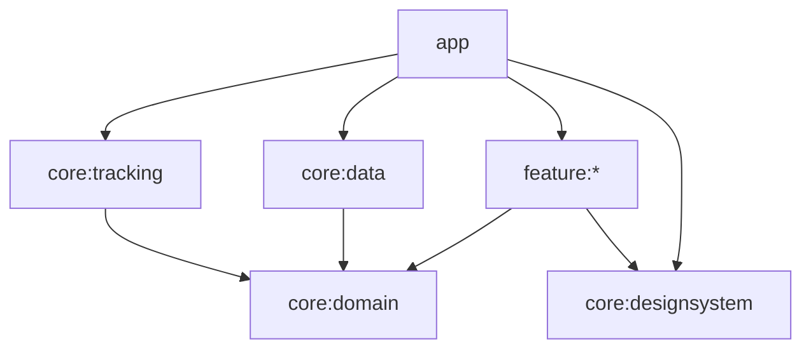

# Arquitetura

O projeto usa Clean Architecture para direcionar as dependências, MVVM para a apresentação e fluxo unidirecional de ações e estado na Atividade. Os módulos definem limites de compilação; os pacotes internos separam responsabilidades. As features contêm apresentação, enquanto domínio e implementações de dados ficam nos módulos compartilhados.

## Dependências e composição



As setas representam dependências de compilação. Jornada, Atividade e Mochila também dependem de `feature:missions` para reutilizar sua apresentação. Os ViewModels recebem interfaces de domínio; Hilt conecta os contratos aos repositórios e ao acompanhamento Android. As features não importam DAOs, entidades Room ou o serviço.

## Organização dos módulos

Os diretórios abaixo representam pacotes existentes sob `src/main/java`. Testes ficam nos respectivos `src/test` e `src/androidTest`, acompanhando o pacote da responsabilidade testada.

```text
app
├── BoraApplication.kt
├── MainActivity.kt
└── navigation
    ├── AdventureApp.kt
    ├── AppDestination.kt
    └── AppNavigationBar.kt

core:domain
├── model
│   ├── hero
│   ├── inventory
│   ├── location
│   ├── mission
│   ├── player
│   └── workout
├── repository
├── rules
│   ├── combat
│   ├── location
│   ├── mission
│   └── workout
├── tracking
└── error

core:data
├── local
│   ├── database
│   ├── dao
│   ├── entity
│   ├── migration
│   └── preferences
├── remote/cep
├── location
├── mapper
├── repository
└── di

core:tracking
├── service
├── controller
├── state
├── time
└── di

core:designsystem
├── theme
├── components
└── illustration
```

| Feature | Pacotes sob `presentation` |
| --- | --- |
| `journey` | `screen`, `components`, `state`, `viewmodel` |
| `activity` | `screen`, `components`, `map`, `permissions`, `formatter`, `action`, `state`, `viewmodel` |
| `backpack` | `screen`, `components`, `viewmodel` |
| `profile` | `screen`, `components`, `form`, `state`, `viewmodel` |
| `missions` | `components`, `state`, `viewmodel` |

`build-logic/src/main/kotlin` reúne os plugins de convenção Android library, Compose, Hilt e feature. As versões são centralizadas em `gradle/libs.versions.toml`.

## Domínio

`core:domain` usa Kotlin/JVM e coroutines, sem Android, Room ou Hilt. `model` contém tipos de negócio; `repository` define contratos de armazenamento e consulta; `tracking` define `WorkoutTracker` e `WorkoutTimeSource`; `rules` reúne cálculos e coordenação; `error` contém a exceção de consulta de CEP.

`QuestPoint` exige título não vazio de até 60 caracteres e coordenadas válidas. `PlayerProfile` mantém medidas numéricas e seus limites. `MissionRules` valida os requisitos de uma missão gerada e calcula a recompensa somente quando a meta foi concluída. Essas regras independem do banco.

`WorkoutType` contém `WALK` e `RUN`, sem rótulos de apresentação. A duração permanece numérica no domínio; `formatActivityTime` e os nomes exibidos das modalidades pertencem a `feature:activity/presentation/formatter`.

`WorkoutSessionManager` coordena iniciar, pausar, retomar, finalizar e cancelar. Recebe os contratos de repositório, relógio e gerador de ID. Usa tempo monotônico para duração e tempo civil para o início. Retomar reinicia a referência do sensor e cria um segmento; deslocamentos entre segmentos não entram na distância. Finalizar produz um rascunho, que pode ser salvo ou descartado separadamente.

O serviço chama seus métodos serialmente. O gerenciador publica a transição após persistir o checkpoint; sessões interrompidas podem ser recuperadas como pausadas. `WorkoutClock`, `StepCounter`, os filtros de GPS e os cálculos de distância e calorias também ficam no domínio. Consultas simples usam os contratos diretamente, sem classes que apenas repassem chamadas.

## Dados e compatibilidade

`local/database` contém `GameDatabase`; `dao` contém consultas; `entity` contém as representações Room; `migration` contém as migrações; `preferences` contém as chaves DataStore e o codec dos objetivos. Conversões entre persistência, resposta remota e domínio ficam em `mapper`.

`repository` implementa os contratos de domínio. `RoomAdventureRepository` e `RoomMissionRepository` executam regras e atualizações na mesma transação. No resgate, experiência, ouro, inventário e estado da missão são confirmados juntos; o repositório também impede uma segunda missão ativa e resgate duplicado. As regras de recompensa permanecem em `MissionRules`.

`DataStorePlayerRepository` armazena perfil e objetivos pessoais. `HttpCepRepository` normaliza a consulta e usa `remote/cep/CepRemoteDataSource`, responsável pelo transporte HTTP e leitura da resposta. `location/AndroidLocationRepository` adapta a localização de visualização para os tipos do domínio. `di` fornece banco, dispatchers e vínculos das implementações.

`RoomWorkoutRepository` mantém resumos em `workouts` e pontos em `workout_points`. Checkpoints inserem apenas pontos novos e atualizam o resumo na mesma transação. Um lote inválido reverte a operação; excluir a atividade remove os pontos por chave estrangeira. O histórico contém resumos com `route` vazio. `observeRoute(id)` carrega o percurso exibido; `current()` recupera os pontos necessários para retomar.

Salvar e descartar retornam `APPLIED`, `NOT_FOUND` ou `INVALID_STATE`. As consultas condicionais impedem alterações incompatíveis e checkpoints tardios sobre resultados finalizados.

O arquivo continua sendo `borarpg.db`, na versão **5**, com identidade **`ea976d3679146d8b01d46e65885c1c8c`**. A reorganização mudou somente o FQN da classe para `com.borarpg.data.local.database.GameDatabase` e o diretório de exportação para `core/data/schemas/com.borarpg.data.local.database.GameDatabase`. Os schemas históricos foram movidos com o mesmo conteúdo. A alteração de pacote não muda tabelas nem exige migração adicional. A migração 4→5 já existente continua convertendo os percursos JSON em pontos ordenados.

## Integração Android

`service/StepTrackingService` mantém notificação, GPS e sensor. Converte callbacks Android em `TrackingCommand`, processados em sequência; o gerenciador de domínio decide as mudanças de sessão. O serviço não recebe DAOs nem entidades.

`controller/TrackingController` implementa `WorkoutTracker` e envia comandos ao serviço após a recuperação inicial. `state/TrackingRuntime` compartilha o estado durante a vida do processo pelo Hilt. `time/AndroidWorkoutTimeSource` fornece os relógios da plataforma, e `di/TrackingModule` conecta os contratos. O banco permite recuperar uma interrupção do processo; o serviço usa `START_NOT_STICKY`.

## Apresentação e navegação

As composables `Route` obtêm ViewModels pelo Hilt, coletam seus estados com o ciclo de vida e conectam callbacks. As `Screen` recebem estados e ações, sem receber ViewModels. Componentes menores recebem somente os dados e callbacks necessários.

Na Atividade, `ActivityRoute` combina exercício, missões, CEP, locais salvos e permissões em `ActivityUiState`. `ActivityScreen` envia `ActivityAction`; a Route encaminha comandos aos ViewModels e abre configurações da plataforma quando necessário. Estado visual local do mapa e diálogos permanece no Compose.

O fluxo dos exercícios é `WorkoutAction → WorkoutViewModel → WorkoutUiState → Compose`. O ViewModel combina resumos persistidos, percurso selecionado, tracking e escolhas da interface. O percurso é associado ao ID para evitar exibir dados de uma consulta anterior em outra atividade. Operações incompatíveis e salvamentos simultâneos são bloqueados; o gerenciador valida novamente as transições. A tela observa a sessão existente, inclusive quando sua execução ocorre em segundo plano.

`permissions` adapta solicitações de localização e atividade física; `map` encapsula MapLibre e a conversão de coordenadas; `formatter` prepara duração e nomes para exibição. `WorkoutPanel` e `ObjectiveDetails` recebem estado e callbacks. A expansão do painel é estado visual local salvo pelo Compose. `WorkoutControls` mantém o launcher de permissões e `WorkoutDialogs` compostos fora da área animada; recolher o painel não interrompe callbacks, diálogos ou a sessão.

As outras features mantêm MVVM com métodos diretos. `ProfileForm` representa textos em edição e converte vírgula decimal para as medidas numéricas de `PlayerProfile`. `feature:missions` fornece estado e componentes compartilhados por Jornada, Atividade e Mochila.

Em `app/navigation`, `AppDestination` representa as abas como enum, substituindo índices numéricos. `AdventureApp` mantém a seleção com `rememberSaveable` e apresenta a Route correspondente; `AppNavigationBar` renderiza a seleção. `BoraApplication` e `MainActivity` são os pontos de entrada Hilt.

`core:designsystem` concentra cores e `BoraTheme` em `theme`, componentes como `Eyebrow` e `Tag` em `components` e a arte `GuardianArt` em `illustration`. Não depende das features nem contém regras de negócio.

## Verificação de arquitetura e testes

`gradle/architecture.gradle.kts` define `checkArchitecture`, também executada pelas tarefas `check`. A verificação inspeciona dependências Gradle e arquivos Kotlin de `main`, `test` e `androidTest`:

- Domínio não pode depender de outro módulo nem importar Android, AndroidX, Hilt, injeção ou coroutines Android.
- Dados e tracking só podem depender de seus próprios tipos e dos contratos de domínio.
- Design system não pode depender de outros módulos do aplicativo.
- Features podem usar domínio, design system e a apresentação compartilhada de missões; outros módulos de infraestrutura e features não são permitidos.
- O diretório de cada arquivo deve corresponder ao pacote declarado.
- Todos os imports devem ser explícitos, sem wildcard.

A suíte JVM exercita regras, invariantes, sessão, formulário, formatação e ViewModels. Os testes instrumentados verificam persistência, migrações, abertura de banco v5 existente após a mudança de pacote, atomicidade, cascata, resgate único e composição Hilt. Os comandos estão no [README](../README.md). Precisão do GPS, bateria e execução prolongada também exigem validação em aparelho físico.
